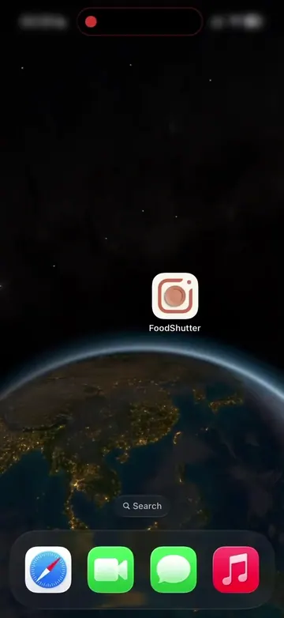
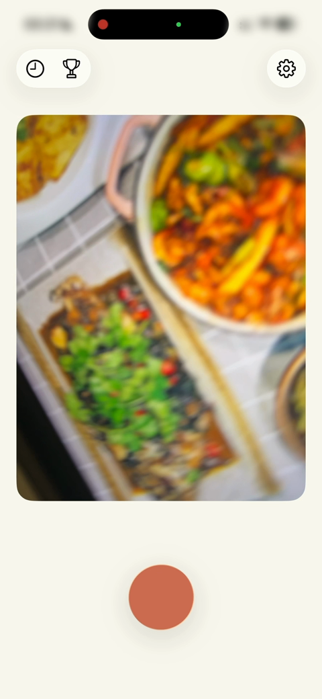
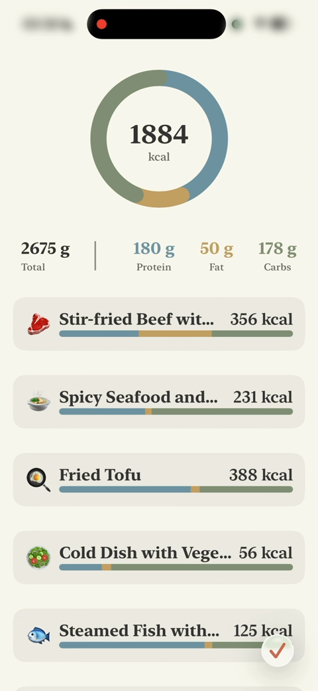
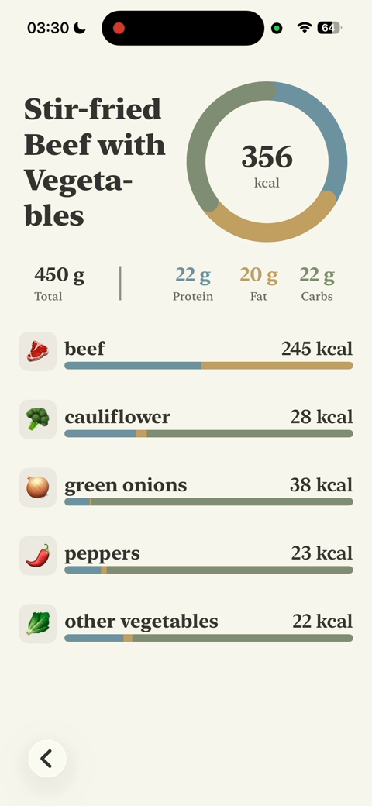
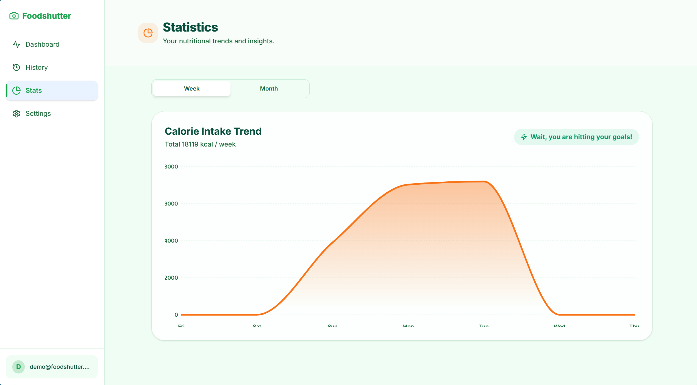
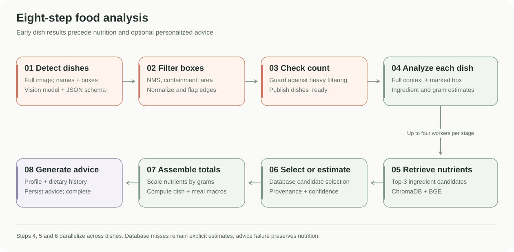

<p align="center">
  
</p>

<h1 align="center">FoodShutter</h1>

<p align="center">Photo-based nutrition tracking, with a native iOS app and a web companion.</p>

<p align="center">
  <a href="LICENSE">MIT License</a> ·
  <a href="iOSApp/project.yml">iOS 26+</a> ·
  <a href="Backend/pyproject.toml">FastAPI</a> ·
  <a href="web/package.json">Next.js 16</a>
</p>

<p align="center">
  <a href="#demo">Demo</a> ·
  <a href="docs/getting-started.md">Getting started</a> ·
  <a href="docs/architecture.md">Architecture</a> ·
  <a href="docs/README.md">Documentation</a> ·
  <a href="README.zh-CN.md">简体中文</a>
</p>

FoodShutter turns a meal photograph into detected dishes, ingredient estimates, calories and macronutrients. The iOS app captures meals and presents analysis in stages. A Python service combines vision models with nutrition retrieval, while Supabase stores accounts and meal records for both clients.

The project was developed by a six-person team for a software project management course. This repository contains the working prototype, model experiments and engineering documentation. Running the full application requires configured cloud services; the [setup guide](docs/getting-started.md) and [release readiness notes](docs/deployment.md) describe the current requirements.

<a name="demo" id="demo"></a>
<h2><picture><source media="(max-width: 600px)" srcset="docs/assets/section-demo.mobile.svg" /></picture></h2>

The complete course film includes sign-in, onboarding, capture, analysis, ingredient detail and recommendations. The silent preview below loops automatically; expand the player to watch with the original audio.

<p align="center">
  <picture>
    <source media="(prefers-reduced-motion: reduce)" srcset="docs/assets/ios-nutrition.png" />
    
  </picture>
</p>

<details>
  <summary>Play the complete film with audio, about 60 seconds</summary>
  <div align="center">

https://github.com/user-attachments/assets/7c632762-cb31-401a-aae9-c211d5f3af00

  </div>
</details>

<p align="center"><a href="docs/assets/foodshutter-film.mp4">Complete video file</a></p>

Screens captured from the same recording:

<table>
  <tr>
    <th>Capture a meal</th>
    <th>Review meal nutrition</th>
    <th>Inspect ingredients</th>
  </tr>
  <tr>
    <td align="center"></td>
    <td align="center"></td>
    <td align="center"></td>
  </tr>
</table>

[Full web walkthrough, about 35 seconds](docs/assets/web-walkthrough.mp4) · [Short iOS excerpt](docs/assets/ios-demo.mp4) · [Demo guide and media sources](docs/demo.md)

<details>
  <summary>Web companion: meal history and nutrition trends</summary>
  <br />
  
  <p>The web client reads shared meal records and provides a dashboard, history, weekly or monthly statistics, and appearance settings.</p>
<div align="center">

https://github.com/user-attachments/assets/285e5be6-b7c1-4ec0-ac44-80cce7d0b54c

</div>
</details>

The recording shows the course demonstration build. Its displayed nutrition values are estimates; the current source and deployment requirements are documented separately.

<a name="what-the-project-implements" id="what-the-project-implements"></a>
<h2><picture><source media="(max-width: 600px)" srcset="docs/assets/section-features.mobile.svg" /></picture></h2>

| Capability | Implementation |
| --- | --- |
| Meal capture and staged results | Native camera capture, authenticated upload, early dish list, then nutrition details |
| Multiple dishes in one image | Vision detection, bounding-box filtering, per-dish analysis with full meal context |
| Ingredient nutrition retrieval | USDA Foundation Foods, BGE embeddings, ChromaDB semantic and lexical search |
| Traceable estimates | Ingredient source labels, food database IDs and qualitative confidence grades |
| Personal dietary context | iOS profile, nutrition targets, meal advice and next-meal recommendation |
| History across clients | Supabase meal records, iOS history, web dashboard and nutrition statistics |
| Progress and achievements | iOS nutrition rings, target ranges and trophy views |

Some course scope items remain incomplete: web suggestions use sample messages, web nutrition search needs a matching backend endpoint, and PDF/Excel export is not implemented in this tree. See the [capability status](docs/architecture.md#capability-status) for the distinction between implemented features, external dependencies and planned work.

<a name="system-architecture" id="system-architecture"></a>
<h2><picture><source media="(max-width: 600px)" srcset="docs/assets/section-architecture.mobile.svg" /></picture></h2>



The mobile client sends a photograph and its Supabase access token to `POST /analyze`. The API accepts the job with HTTP `202`; results are written to Supabase as processing advances. iOS observes meal status through Realtime and concurrent REST polling. The web companion queries the same meal and dish tables through its Supabase client.

The model endpoint is configurable through an OpenAI-compatible API. Qwen3.5-9B fine-tuning is a separate research and deployment path; it is not a required dependency for running the client or the mocked backend tests.

[Component responsibilities](docs/architecture.md) · [Data contracts](docs/data-model.md) · [API reference](docs/api.md)

<a name="eight-step-analysis" id="eight-step-analysis"></a>
<h2><picture><source media="(max-width: 600px)" srcset="docs/assets/section-pipeline.mobile.svg" /></picture></h2>



1. Detect dish names and bounding boxes from the complete photograph.
2. Remove overlapping or contained boxes, apply area limits and flag image edges.
3. Check retained dish count and recover detections after extreme filtering.
4. Analyze each dish with an annotated image and the other dishes as context.
5. Retrieve nutrition candidates for each ingredient.
6. Select database entries or label model-generated nutrition estimates.
7. Scale nutrients by estimated weight and calculate dish and meal totals.
8. Generate advice from the current meal, user profile and recent dietary history.

Steps 4–6 use up to four worker threads per stage. Model calls request schema-constrained JSON. Missing nutrition data can continue through an explicitly labeled estimate, and an advice-generation failure does not discard completed nutrition results.

[Pipeline details and limits](docs/ai-pipeline.md) · [Fine-tuning and model serving](docs/model-training.md)

<a name="repository-structure" id="repository-structure"></a>
<h2><picture><source media="(max-width: 600px)" srcset="docs/assets/section-structure.mobile.svg" /></picture></h2>

```text
FoodShutter/
├── iOSApp/
│   ├── FoodShutter/App/           Application state and onboarding
│   ├── FoodShutter/Core/          Models, camera, API and Supabase repositories
│   ├── FoodShutter/Features/      Analysis, history, authentication and profile UI
│   ├── FoodShutter/Shared/        Reusable nutrition and suggestion components
│   ├── FoodShutterTesting/        Seven XCTest source files
│   └── project.yml               XcodeGen project definition
├── Backend/
│   ├── api/                      FastAPI routes, token verification and jobs
│   ├── pipeline/                 Eight analysis steps and model client
│   ├── nutrition_db/             USDA cleaning, ChromaDB build and search
│   ├── Finetune/finetune/         Qwen3.5-9B training and comparison scripts
│   ├── tests/                    Pytest suite
│   └── docs/                     Original backend design and integration notes
├── web/
│   ├── app/                      Next.js App Router pages
│   ├── components/               Layout, motion and theme components
│   ├── lib/                      Supabase adapters and application data access
│   └── supabase/functions/       Edge Function integration scaffolding
└── docs/                         Architecture, setup, evaluation and demo assets
```

<a name="run-locally" id="run-locally"></a>
<h2><picture><source media="(max-width: 600px)" srcset="docs/assets/section-setup.mobile.svg" /></picture></h2>

| Component | Requirements | Entry point |
| --- | --- | --- |
| Backend | Python 3.12+, Supabase project, compatible vision/model endpoint | `Backend/api/main.py` |
| Web | Node.js satisfying Next.js 16 requirements, npm, Supabase public configuration | `web/app/` |
| iOS | macOS, Xcode 26 with iOS 26 SDK, signing for a physical device | `iOSApp/FoodShutter.xcodeproj` |

Clone the repository:

```bash
git clone https://github.com/FoodShutter-Development-Team/FoodShutter.git
cd FoodShutter
```

Backend:

```bash
cd Backend
cp .env.example .env
# Fill in your server-side credentials and model configuration.
uv sync
uv run uvicorn api.main:app --host 0.0.0.0 --port 8000
```

Web, in another terminal:

```bash
cd web
cp .env.example .env.local
# Fill in the URL and public anon key for your Supabase project.
npm ci
npm run dev
```

On macOS, open `iOSApp/FoodShutter.xcodeproj`, configure your own Supabase client and backend URL, select the `FoodShutter` scheme, and run on an iOS 26 device. The camera workflow requires a physical device.

Database migrations, RLS policies and trained weights are not included. Complete [service provisioning](docs/getting-started.md#1-provision-supabase) before expecting authenticated meal analysis to work. The checked-in iOS target is iOS 26; the earlier course proposal's iOS 17 target does not describe the current build.

<a name="evaluation-and-engineering" id="evaluation-and-engineering"></a>
<h2><picture><source media="(max-width: 600px)" srcset="docs/assets/section-evaluation.mobile.svg" /></picture></h2>

The final presentation reports a five-angle demonstration of a seven-dish meal. Reported calorie variation was 6.4% for the pipeline and 22.1% for the presentation's baseline. This small comparison measures consistency across photographs, and does not establish nutrition accuracy. [Evaluation methods, results and limitations](docs/evaluation.md) preserve that distinction.

The existing backend test suite was rerun on 14 October 2026 against source baseline `3a7bf20`: 237 tests passed. Overall statement coverage across `pipeline`, `api` and `nutrition_db` was 66.52%; the pipeline directory reached 96.92%. External model and cloud interactions are mocked. iOS XCTest sources are included, but were not executed in the Windows documentation environment. [Testing guide](docs/testing.md)

The course work also covers requirements, scope, estimation, Scrum planning, risk management and configuration control. Estimates and simulated reliability figures are identified as course exercises in the [project context](docs/project-context.md).

<a name="team" id="team"></a>
<h2><picture><source media="(max-width: 600px)" srcset="docs/assets/section-team.mobile.svg" /></picture></h2>

Roles reported in the final course presentation:

| Contributor | Area |
| --- | --- |
| Liu Xiangyu | iOS development, AI pipeline and model fine-tuning |
| Xie Tingyang | Testing, documentation, presentation and deployment |
| Liu Simiao | Presentation and illustration design |
| Zhou Yunhui | Documentation |
| Li Peichen | Web frontend and data synchronization |
| Han Chengxu | Backend development and web integration support |

These roles credit the course team. Git authorship remains attached to actual repository commits.

<a name="contributing-and-license" id="contributing-and-license"></a>
<h2><picture><source media="(max-width: 600px)" srcset="docs/assets/section-contributing.mobile.svg" /></picture></h2>

Read [CONTRIBUTING.md](CONTRIBUTING.md) for development and review expectations, and [SECURITY.md](SECURITY.md) for credential handling and the current security scope.

FoodShutter's source code is available under the [MIT License](LICENSE). Third-party models, training data and nutrition datasets have their own terms. The application provides estimated nutrition information and is outside the course's scope for medical diagnosis or treatment.

<p></p>
