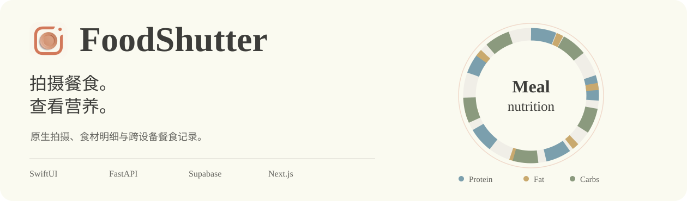

<h1 align="center"><a href="#演示"></a></h1>

<p align="center">
  <a href="#演示"></a>
  <a href="docs/getting-started.md"></a>
  <a href="docs/architecture.md"></a>
  <a href="README.md"></a>
</p>

<p align="center"><a href="LICENSE">MIT License</a> · <a href="iOSApp/project.yml">iOS 26+</a> · <a href="docs/README.md">技术文档</a></p>

FoodShutter 从一张餐食照片中检测多道菜品，估算食材、份量和宏量营养，并结合用户资料及近期饮食生成建议。iOS 负责拍摄与结果展示，Python 后端执行分析，Supabase 保存账户和餐食记录，网页端提供历史与统计视图。

本项目由六人团队完成，是软件项目管理课程作业。仓库包含可运行原型、模型实验和工程文档。完整运行需要自行配置云服务；项目当前的运行条件和发布前要求见[运行指南](docs/getting-started.md)与[部署说明](docs/deployment.md)。

<a name="演示"></a>
<h2></h2>

完整视频保留期末演示的登录、引导、拍摄、分析、食材明细和建议流程，以及原始音轨。

https://github.com/user-attachments/assets/7c632762-cb31-401a-aae9-c211d5f3af00

[完整视频文件](docs/assets/foodshutter-film.mp4)

以下截图来自同一段实际录屏。

<table>
  <tr><th>拍摄餐食</th><th>查看整餐营养</th><th>查看食材明细</th></tr>
  <tr>
    <td align="center"></td>
    <td align="center"></td>
    <td align="center"></td>
  </tr>
</table>

[完整网页录像，约 35 秒](docs/assets/web-walkthrough.mp4) · [iOS 精简节选](docs/assets/ios-demo.mp4) · [素材来源](docs/demo.md)

<details>
  <summary>网页端营养统计</summary>
  <br />
  


https://github.com/user-attachments/assets/285e5be6-b7c1-4ec0-ac44-80cce7d0b54c

</details>

录屏展示课程演示版本，页面中的营养值属于估算结果。当前源码与演示版本的差异在技术文档中单独说明。

<a name="功能"></a>
<h2></h2>

| 功能 | 当前实现 |
| --- | --- |
| 拍摄与阶段性结果 | 原生相机、认证上传、先显示菜品，再显示完整营养 |
| 多菜品识别 | 视觉模型检测、位置框过滤、逐道菜分析 |
| 食材营养检索 | USDA Foundation Foods、BGE 嵌入、ChromaDB 检索 |
| 估算来源 | 食材来源标记、数据库记录 ID、定性置信等级 |
| 个性化信息 | iOS 个人资料、营养目标、饮食建议和下一餐推荐 |
| 历史与统计 | Supabase 餐食记录、iOS 历史、网页仪表盘和趋势图 |
| 目标与成就 | 营养环、目标区间、奖杯界面 |

网页建议当前使用示例消息；营养搜索代理需要尚未提供的 `/search` 接口；Excel/PDF 导出仍属于课程规划内容。[功能状态表](docs/architecture.md#capability-status)列出了已实现内容和外部依赖。

<a name="系统架构"></a>
<h2></h2>


iOS 使用 SwiftUI、MVVM 和 Repository 分工。客户端向 `POST /analyze` 上传照片及 Supabase 访问令牌，后端返回 HTTP `202` 和任务对应的餐食 ID，随后分阶段保存结果。iOS 同时使用 Realtime 订阅和 REST 轮询观察状态；网页端通过 Supabase 查询餐食与菜品数据。

模型服务通过 OpenAI 兼容接口配置。Qwen3.5-9B 微调属于独立实验和部署方案，完整模型及适配器没有随仓库分发。当前后台任务运行在 API 进程内，尚未采用持久化任务队列。

[架构与职责](docs/architecture.md) · [数据模型与单位](docs/data-model.md) · [API 说明](docs/api.md)

<a name="八步分析"></a>
<h2></h2>


1. 从完整照片检测菜品名称和位置框。
2. 过滤重叠、包含关系和异常面积，标记图像边缘。
3. 检查保留数量，在过滤过多时恢复检测结果。
4. 结合完整场景与标记位置，估算每道菜的食材和克重。
5. 为食材检索营养候选记录。
6. 选择数据库条目，或明确标记模型估算值。
7. 按克重换算营养，计算菜品与整餐合计。
8. 根据个人资料和近期记录生成饮食建议。

第 4–6 步分别使用最多四个工作线程处理不同菜品。模型请求使用 JSON Schema 约束；检索缺失时保留估算来源；建议生成失败时仍可保存已完成的营养结果。

[流程与限制](docs/ai-pipeline.md) · [模型训练与服务](docs/model-training.md)

<a name="项目结构"></a>
<h2></h2>

```text
iOSApp/
  FoodShutter/App/          应用状态、认证路由与引导
  FoodShutter/Core/         领域模型、相机、API、Supabase 仓储
  FoodShutter/Features/     分析、历史、认证、资料与成就页面
  FoodShutter/Shared/       可复用营养和建议组件
  FoodShutterTesting/      XCTest 源码
  project.yml              XcodeGen 项目定义
Backend/
  api/                     接口、令牌验证与后台任务
  pipeline/                八步分析和模型客户端
  nutrition_db/            USDA 清洗、索引构建与检索
  Finetune/finetune/        Qwen 微调与比较实验
  tests/                   Pytest 测试
web/
  app/                     Next.js 页面
  components/              布局、动效与主题
  lib/                     Supabase 与业务数据访问
  supabase/functions/      Edge Function 接入代码
docs/                      架构、运行、评估与演示资料
```

<a name="运行"></a>
<h2></h2>

| 组件 | 环境 |
| --- | --- |
| 后端 | Python 3.12+、Supabase 项目、支持图像和结构化输出的模型接口 |
| 网页 | 与 Next.js 16 兼容的 Node.js、npm、Supabase 公开配置 |
| iOS | macOS、Xcode 26、iOS 26 SDK；相机流程需要真机 |

```bash
git clone https://github.com/FoodShutter-Development-Team/FoodShutter.git
cd FoodShutter/Backend
cp .env.example .env
# 填写自己的服务端配置。
uv sync
uv run uvicorn api.main:app --host 0.0.0.0 --port 8000
```

另开终端，在 `web/` 内复制 `.env.example` 为 `.env.local`，填写公开 Supabase 配置，执行 `npm ci` 和 `npm run dev`。PowerShell 可用 `Copy-Item` 代替 `cp`。

在 macOS 打开 `iOSApp/FoodShutter.xcodeproj`，设置自己的 Supabase 配置、后端地址和开发签名后运行。当前工程最低版本为 iOS 26，早期课程文档中的 iOS 17 属于原始计划。

数据库迁移、RLS 策略和训练权重没有包含在仓库中。完整运行前需完成[服务配置](docs/getting-started.md#1-provision-supabase)。后端模拟测试可独立于实际云服务执行。

<a name="评估与质量"></a>
<h2></h2>

期末 PPT 报告了同一份七道菜餐食的五个视角比较：热量变异系数为流程 6.4%、基线 22.1%。这说明该小样例中的跨视角一致性，不能证明普遍的营养准确率。方法、原始证据范围和限制见[评估说明](docs/evaluation.md)。

2026 年 10 月 14 日，针对源码基线 `3a7bf20` 重新运行了后端测试，237 项全部通过。`pipeline`、`api`、`nutrition_db` 整体语句覆盖率为 66.52%，其中流程目录为 96.92%。模型和云调用使用模拟对象。Windows 文档环境没有执行 iOS XCTest，见[测试说明](docs/testing.md)。

当前食材营养保存与 iOS 读取存在单位差异，发布前应修复并增加实际读写回归。数据库可复现部署、私有照片访问和部分网页功能也需要补充。[部署文档](docs/deployment.md)按实际代码列出具体工作。

课程中的需求、估算、Scrum、风险和配置管理材料见[项目背景](docs/project-context.md)。其中可靠性与可用性数据属于模拟计算，CMM 等级属于课程自评。

<a name="团队"></a>
<h2></h2>

| 成员 | 期末汇报记录的职责 |
| --- | --- |
| Liu Xiangyu | iOS、AI 后端流程、模型微调 |
| Xie Tingyang | 测试、文档与汇报、部署 |
| Liu Simiao | 汇报与插图设计 |
| Zhou Yunhui | 文档 |
| Li Peichen | 网页前端与数据同步 |
| Han Chengxu | 后端与网页接入支持 |

团队职责用于课程贡献说明，Git 作者信息保留真实提交归属。

<a name="参与开发与许可"></a>
<h2></h2>

开发流程见 [CONTRIBUTING.md](CONTRIBUTING.md)，凭据和当前安全设置见 [SECURITY.md](SECURITY.md)。项目代码采用 [MIT 许可](LICENSE)。模型、训练数据和营养数据遵守各自许可。本应用提供营养估算，不在课程中的医疗诊断或治疗范围内。

<p></p>
